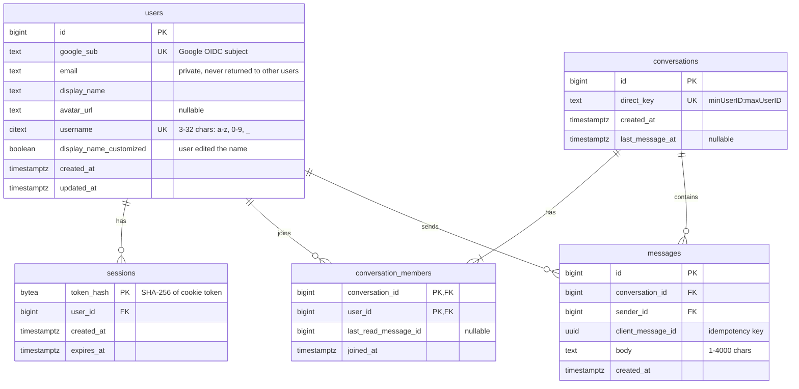

# Database Design

PostgreSQL 17. The schema is defined by versioned migrations in [`server/migrations/`](../server/migrations/), which the server applies at startup (see [ADR 0005](adr/0005-single-backend-instance.md)). This document explains the schema; the migrations are the source of truth.

## Entity relationship diagram

## Tables

### `users`

| Column / constraint | Why |
|---|---|
| `id` identity primary key | Internal ID. Never exposed as an OAuth identity and never changed by the user (PRD §6.2). |
| `google_sub` unique | Google's stable account ID. Accounts are matched by this, not by email, so an email change never creates a duplicate account (PRD §6.1). |
| `email` | Kept for the owner's records. Never included in public profiles or search results. |
| `display_name` + `display_name_customized` | Starts as the Google name and is refreshed on each sign-in, until the user edits it in settings. From then on `display_name_customized` is true and sign-in keeps the user's choice (migration 000002). |
| `username` `CITEXT` unique + `CHECK` | Case-insensitive uniqueness: `Tomy` and `tomy` cannot both exist. The check enforces the allowed format at the database level as well as in the service. |

### `sessions`

See [ADR 0001](adr/0001-database-backed-sessions.md). Only the SHA-256 hash of the token is stored, so a database leak does not leak usable sessions. Deleting a user cascades to their sessions.

### `conversations`

| Column / constraint | Why |
|---|---|
| `direct_key` unique | For a direct conversation between users 7 and 3, the key is `3:7` (smaller ID first). Two users therefore always map to the same conversation, even if both press **Message** at the same moment (PRD §6.4). |
| `last_message_at` | Denormalized timestamp, updated with each message, so the conversation list can be sorted without scanning `messages`. |

### `conversation_members`

Composite primary key `(conversation_id, user_id)` prevents adding the same user twice. Every read or write of a conversation checks for a row here (PRD §6.4). `last_read_message_id` supports unread indicators (PRD §6.6).

### `messages`

| Column / constraint | Why |
|---|---|
| `id` identity | Increasing integer that gives a consistent order and works as a pagination cursor. |
| `UNIQUE (sender_id, client_message_id)` | Makes sends idempotent: a retried message hits the constraint and the existing row is returned instead (see [ADR 0003](adr/0003-postgres-source-of-truth.md)). |
| `CHECK (char_length(body) BETWEEN 1 AND 4000)` | Rejects empty and oversized messages at the database level (PRD §8). |
| `sender_id` without `ON DELETE CASCADE` | A user who has sent messages cannot be deleted by accident. How to handle account deletion is still an open decision. |

## Indexes and the queries they serve

| Index | Query |
|---|---|
| `users_username_prefix_idx` on `lower(username) text_pattern_ops` | Username prefix search: `WHERE lower(username) LIKE 'tom%'` |
| `sessions_user_id_idx` | Sign out everywhere: `DELETE FROM sessions WHERE user_id = $1` |
| `sessions_expires_at_idx` | Expired session cleanup |
| `conversation_members_user_id_idx` | "My conversations": find all conversations for a user |
| `conversations_last_message_at_idx` | Sort the conversation list by recent activity |
| `messages_conversation_id_id_idx` on `(conversation_id, id DESC)` | History pages (`WHERE conversation_id = $1 AND id < $cursor ORDER BY id DESC LIMIT n`) and sync after reconnect (`id > $last_seen`) |

## Pagination

Message history uses **keyset (cursor) pagination** on `id`, not `OFFSET`. Each page is an index range scan, so it stays fast however long the conversation grows, and new messages arriving between requests never shift or duplicate items across pages.

## Changing the schema

1. Add a new pair `server/migrations/NNNNNN_description.up.sql` and `.down.sql`. Never edit a migration that has already been applied anywhere.
2. Restart the server (or `docker compose up --build server`) to apply it.
3. Update this document if tables, constraints, or indexes change.
